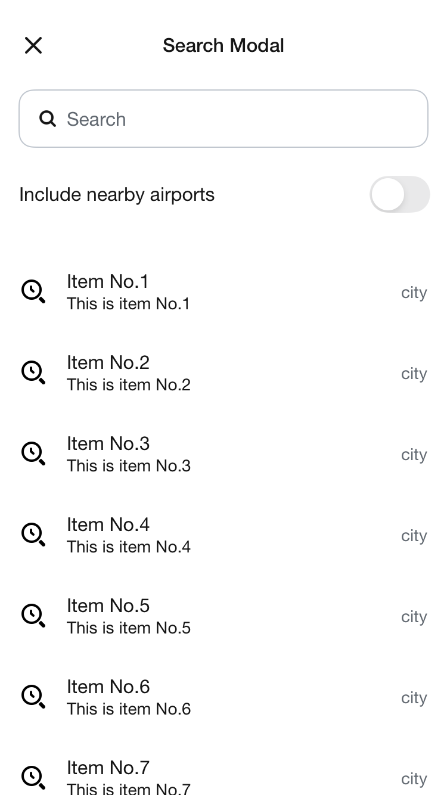
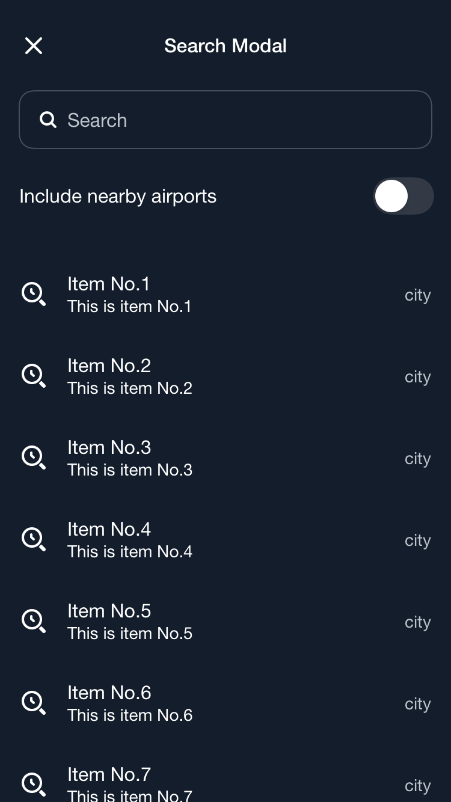

# AppSearchModal

[](https://backpack.github.io/ios/versions/latest/swiftui/Structs/BPKAppSearchModal.html)
[](https://github.com/Skyscanner/backpack-ios/tree/main/Backpack-SwiftUI/AppSearchModal)

## Content

| Day | Night |
| --- | --- |
|  |  |


## Loading

| Day | Night |
| --- | --- |
|  |  |


## Error

| Day | Night |
| --- | --- |
|  |  |

## Usage

Example of a AppSearchModal in Content state:

```swift
import Backpack_SwiftUI
BPKAppSearchModal(
    title: "Search Modal",
    inputPrefix: BPKSearchInputSummary.InputPrefix.text("Prefix")
    clearAction: BPKSearchInputSummary.ClearAction(accessibilityLabel: "Clear", action: {}),
    inputHint: "Search",
    results: .content(.init(
        sections: [ /* sections */ ],
        shortcuts: [ /*  shortcuts */ ]
    )),
    inputPrefix: BPKSearchInputSummary.InputPrefix.text("Prefix"),
    clearAction: BPKSearchInputSummary.ClearAction(accessibilityLabel: "Clear", action: {}),
    closeAccessibilityLabel: "Close",
    onClose: { }
)
```

Example of a AppSearchModal in Loading state:

```swift
import Backpack_SwiftUI

BPKAppSearchModal(
    title: "Search Modal",
    inputText: $myText,
    inputHint: "Search",
    results: .loading(.init(accessibilityLabel: "Loading")),
    inputPrefix: BPKSearchInputSummary.InputPrefix.text("Prefix"),
    clearAction: BPKSearchInputSummary.ClearAction(accessibilityLabel: "Clear", action: {}),
    closeAccessibilityLabel: "Close",
    onClose: { /* close modal*/ }
)
```

Example of a AppSearchModal in Error state:

```swift
import Backpack_SwiftUI

BPKAppSearchModal(
    title: "Search Modal",
    inputText: $myText,
    inputHint: "Search",
    results: .error( .init(
        title: "Title",
        description: "This is the subtitle",
        action: .init( text: "Title for button", onActionSelected: { /* action on button Tapped */ }),
        image: Image("photo")

    )),
    closeAccessibilityLabel: "Close",
    inputPrefix: BPKSearchInputSummary.InputPrefix.text("Prefix"),
    clearAction: BPKSearchInputSummary.ClearAction(accessibilityLabel: "Clear", action: {}),
    onClose: { /* close modal*/ }
)
```

## Input accessory (experimental)

Use `inputAccessory` to add a switch or filter between the search input and the results. The accessory stays fixed while results scroll and remains visible in content, loading and error states. The modal provides horizontal padding. Existing callers and search-input visibility are unchanged.

```swift
BPKAppSearchModal(
    title: "Where to?",
    inputText: $query,
    inputHint: "Country, city or airport",
    results: results,
    closeAccessibilityLabel: "Close",
    clearAction: .init(accessibilityLabel: "Clear", action: { query = "" }),
    onClose: dismiss
)
.inputAccessory {
    BPKSwitch(isOn: $includeNearbyAirports, text: "Include nearby airports", truncate: false)
        .padding(.vertical, .md)
}
```

The consumer owns the control's state, label, accessibility identifiers and feature eligibility. The accessory API is experimental and subject to change.

| Day | Night |
| --- | --- |
|  |  |
