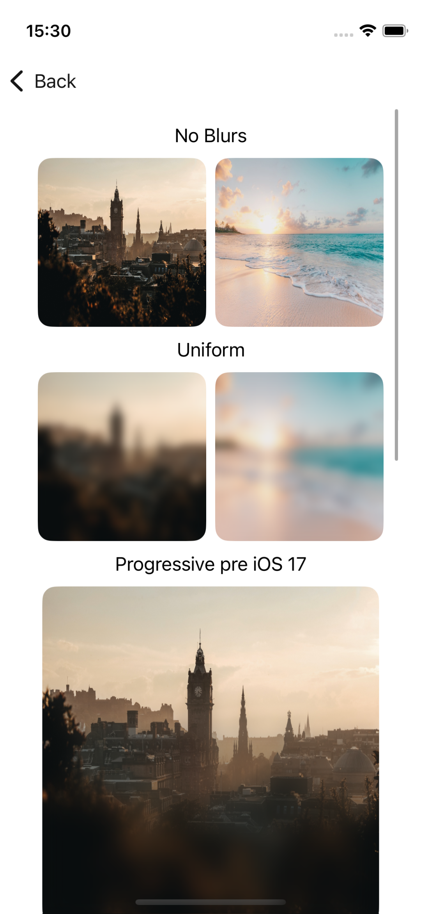
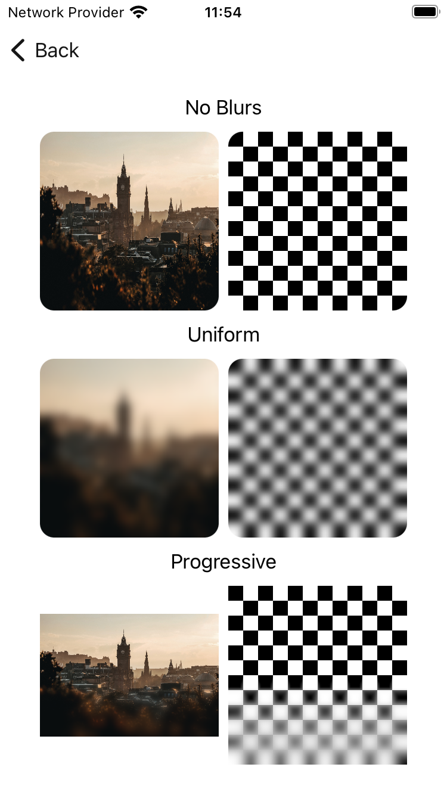

# Blur Effects

[](https://backpack.github.io/ios/versions/latest/swiftui/Structs/BlurEffects.html)
[](https://github.com/Skyscanner/backpack-ios/tree/main/Backpack-SwiftUI/Blur)

## Previews

| Uniform | Metal Progressive Blur |
| --- | --- |
|  |  |

## Usage

### Uniform Blur

Applies a fixed-radius blur to any SwiftUI view.

```swift
BPKUniformBlur(opaque: Bool)
```

**Example:**

```swift
Text("Blurred Content")
    .blur(BPKUniformBlur(opaque: false))

Image("example-image")
    .resizable()
    .blur(BPKUniformBlur(opaque: true))
```

---

### Metal Progressive Blur

Applies a Metal-based GPU-accelerated variable blur using a vertical gradient mask.

```swift
.someView()
    .bpkProgressiveBlur()
```

**Example:**

```swift
Image("example-image")
    .resizable()
    .bpkProgressiveBlur()
```

---

## Blur Types

### `BPKUniformBlur`

- **Type**: Static blur
- **Radius**: 4pt (default)
- **Performance**: High
- **Use case**: Simple, consistent blur overlays, opaque bool depending on image background

### `bpkProgressiveBlur()`

- **Type**: Shader-based mask blur
- **Radius**: 24pt (default)
- **Performance**: GPU-accelerated
- **Use case**: Progressive blur at the bottom of a view

---

## Platform Parity & Gradient Notes

### Shader parity: iOS Metal vs Android AGSL

Both platforms apply progressive blur only to the bottom half of the view/composable, ramping intensity
from the vertical midpoint (no blur) to the bottom edge (maximum blur). However, the two implementations
scale intensity differently:

- **iOS (`bpkProgressiveBlur`)**: the mask alpha driving the Metal shader's blur radius only reaches `0.5`
  at the bottom edge (see gradient stops below), so the effective maximum blur is roughly half of the
  nominal `radius: 24` passed to the shader (~12pt).
- **Android AGSL**: `blurSigma` is interpolated linearly from `0` at the midpoint to the *full* `uMaxSigma`
  (4dp) at the bottom edge, with no equivalent 0.5 cap.

This is an accepted, documented difference rather than a defect: the two shaders use different units
(points vs dp) and different intensity curves by design, but both produce the same qualitative effect
(no blur at the midpoint, strongest blur at the bottom edge, confined to the bottom 50% of the view).
Visual comparison of the recorded snapshots (`screenshots/iPhone-swiftui_blur-progessive___default_lm.png`
on iOS vs `BpkBlurTest_progressiveBlur.png` on Android) confirms the falloff shape is perceptually similar,
though iOS's effective peak intensity is lower relative to its nominal radius.

---

## Accessibility

These visual effects are non-interactive and should be combined with accessible labels or containers as appropriate.

---

