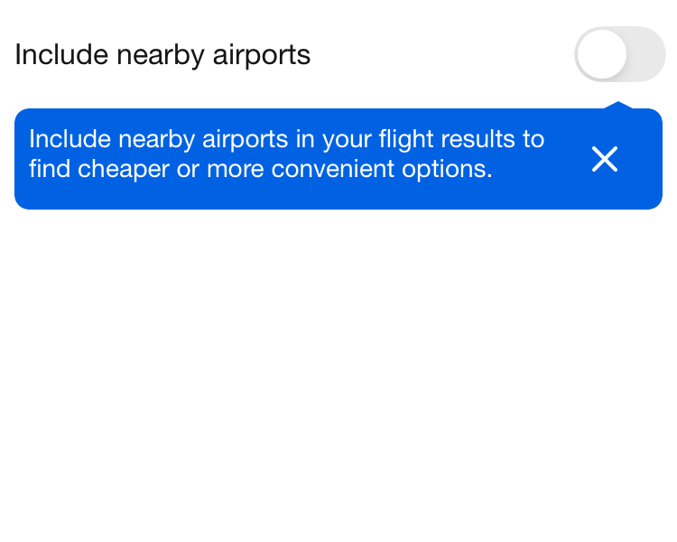
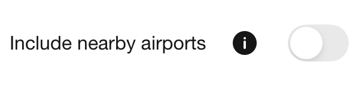

# Backpack-SwiftUI/Switch

[](https://backpack.github.io/ios/versions/latest/swiftui/Structs/BPKSwitch.html)
[](https://github.com/Skyscanner/backpack-ios/tree/main/Backpack-SwiftUI/Switch)

## Default

| Day | Night |
| --- | --- |
|  |  |

## Usage

### Text label

```swift
import SwiftUI
import Backpack_SwiftUI

struct SwitchExampleView: View {
    @State private var isOn = true

    var body: some View {
        BPKSwitch(
            isOn: $isOn,
            text: "Enable notifications"
        )
    }
}
```

### Enabled state

`enabled` controls whether the switch accepts interaction and defaults to `true`.

```swift
BPKSwitch(
    isOn: $isOn,
    text: "Enable notifications",
    enabled: false
)
```

SwiftUI’s `.disabled()` modifier remains supported when a parent needs to disable a larger section of the interface.

### Truncation

`truncate` defaults to `true`. Set it to `false` to allow the label to wrap.

```swift
BPKSwitch(
    isOn: $isOn,
    text: "A longer label that can wrap over multiple lines",
    truncate: false
)
```

### Attributed text

```swift
private var attributedLabel: AttributedString {
    var label = AttributedString("Enable notifications")
    label.foregroundColor = Color(.coreAccentColor)
    return label
}

BPKSwitch(
    isOn: $isOn,
    text: attributedLabel
)
```

### Custom content

Custom content can capture the current binding value directly.

```swift
BPKSwitch(isOn: $isOn) {
    BPKText(isOn ? "Notifications enabled" : "Notifications disabled")
        .padding()
}
```

### Styles

```swift
BPKSwitch(
    isOn: $isOn,
    text: "Enable notifications",
    style: .default
)
```

The On Contrast style visually hides its internal Toggle label so that the custom off-track colour can be applied. Render a visible label alongside the switch when required.

```swift
HStack {
    BPKText("Enable notifications")
        .foregroundColor(.textOnDarkColor)
        .accessibilityHidden(true)

    Spacer()

    BPKSwitch(
        isOn: $isOn,
        text: "Enable notifications",
        style: .onContrast
    )
}
.background(Color(.surfaceContrastColor))
```

Always verify separately composed labels with VoiceOver.

## Alignment

`BPKSwitch` follows the native SwiftUI `Toggle` layout and does not expose a separate vertical-alignment parameter.

## Experimental tooltip (opt-in)

**Experimental API — subject to change.** Keep this behind the consuming app's
experiment flag. This is not a stable design-system pattern and must not be
published to skyscanner.design until it is stabilised. Stabilise or remove the
API within two weeks of the experiment ending.

`experimentalTooltip(_:isPresented:)` overlays an explanation below the switch row
without moving surrounding content. The pointer follows the information button,
or the native switch for the introduction. An optional information button sits
immediately after the label, before the native switch, with a 44-point tap target.
Tapping it again dismisses the explanation. The bubble uses `coreAccentColor` with
`textPrimaryInverseColor` for contrast in light and dark themes.

This is a Backpack SwiftUI overlay, not Apple's TipKit. A parent that has overlapping
siblings must give the switch row a higher `zIndex`; `BPKAppSearchModal` does this
for its input accessory. Omitting the modifier, or
passing `nil`, preserves the standard switch. Opening or closing the tooltip
does not change the switch value.

```swift
@State private var isOn = false
@State private var informationIsPresented = true // First visit only.

BPKSwitch(isOn: $isOn, text: localisedTitle, truncate: false)
    .experimentalTooltip(.init(
        message: localisedExplanation,
        informationAccessibilityLabel: localisedInformationLabel,
        dismissAccessibilityLabel: localisedCloseLabel,
        showsInformationButton: false, // Use true on subsequent visits.
        onPresented: { markIntroductionSeen() }
    ), isPresented: $informationIsPresented)
```

The **consumer owns first-use history**, including persistence, identity, scope
and experiment resets. Read that history once when opening the screen. On the
first visit, start the presentation binding at `true` and hide the information
button. On later visits, start it at `false` and show the information button.
Record exposure from `onPresented`, not when constructing the configuration;
views that never appear must not consume the introduction. Keep the binding in
the screen's state so transient content changes do not show a dismissed tooltip
again.

The information and close controls are separate from the native toggle. They
use localised accessibility labels, support VoiceOver focus and the escape
gesture, and preserve native switch operation. Light, dark, RTL and Dynamic Type
are covered by snapshot tests. The Example app's **Switches → SwiftUI → Open
experimental switch** demonstrates first and subsequent visits without saving
history between Example sessions.

| First visit | Subsequent visit |
| --- | --- |
|  |  |
