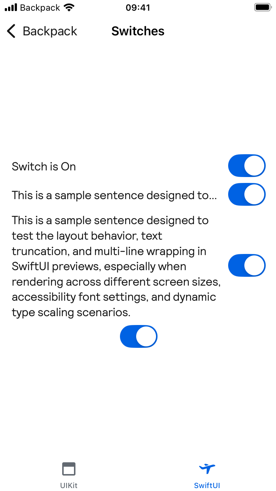
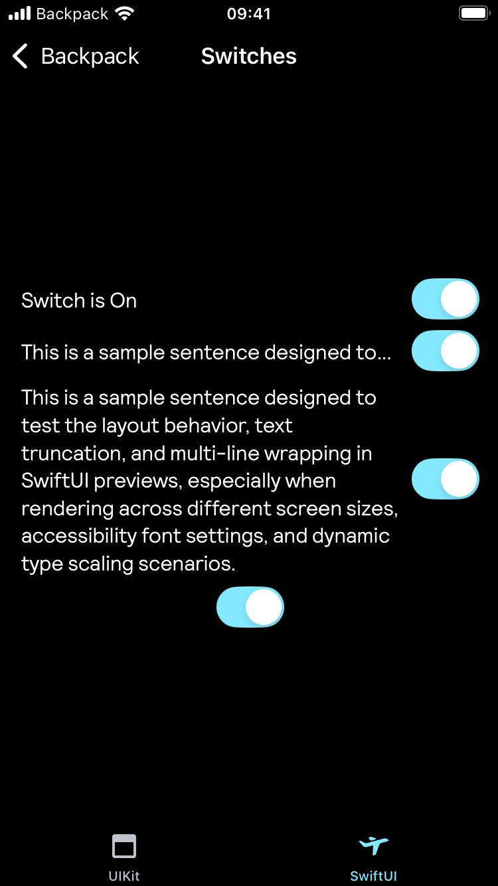

# Backpack-SwiftUI/Switch

[](https://backpack.github.io/ios/versions/latest/swiftui/Structs/BPKSwitch.html)
[](https://github.com/Skyscanner/backpack-ios/tree/main/Backpack-SwiftUI/Switch)

## Default

| Day | Night |
| --- | --- |
|  |  |

## Usage

### Text label

```swift
import SwiftUI
import Backpack_SwiftUI

struct SwitchExampleView: View {
    @State private var isOn = true

    var body: some View {
        BPKSwitch(
            isOn: $isOn,
            text: "Enable notifications"
        )
    }
}
```

### Enabled state

`enabled` controls whether the switch accepts interaction and defaults to `true`.

```swift
BPKSwitch(
    isOn: $isOn,
    text: "Enable notifications",
    enabled: false
)
```

SwiftUI’s `.disabled()` modifier remains supported when a parent needs to disable a larger section of the interface.

### Truncation

`truncate` defaults to `true`. Set it to `false` to allow the label to wrap.

```swift
BPKSwitch(
    isOn: $isOn,
    text: "A longer label that can wrap over multiple lines",
    truncate: false
)
```

### Attributed text

```swift
private var attributedLabel: AttributedString {
    var label = AttributedString("Enable notifications")
    label.foregroundColor = Color(.coreAccentColor)
    return label
}

BPKSwitch(
    isOn: $isOn,
    text: attributedLabel
)
```

### Custom content

Custom content can capture the current binding value directly.

```swift
BPKSwitch(isOn: $isOn) {
    BPKText(isOn ? "Notifications enabled" : "Notifications disabled")
        .padding()
}
```

### Styles

```swift
BPKSwitch(
    isOn: $isOn,
    text: "Enable notifications",
    style: .default
)
```

The On Contrast style visually hides its internal Toggle label so that the custom off-track colour can be applied. Render a visible label alongside the switch when required.

```swift
HStack {
    BPKText("Enable notifications")
        .foregroundColor(.textOnDarkColor)
        .accessibilityHidden(true)

    Spacer()

    BPKSwitch(
        isOn: $isOn,
        text: "Enable notifications",
        style: .onContrast
    )
}
.background(Color(.surfaceContrastColor))
```

Always verify separately composed labels with VoiceOver.

## Alignment

`BPKSwitch` follows the native SwiftUI `Toggle` layout and does not expose a separate vertical-alignment parameter.

## Experimental information and native introduction (opt-in)

**Experimental API — subject to change.** Keep this behind the consuming app's experiment flag. Do not publish it to skyscanner.design until stable. Stabilise or remove it within two weeks of the experiment ending.

`experimentalInformation(_:tooltip:)` adds a persistent grey information button immediately after the label, before the native switch. It retains a 44-point touch target. Tapping it opens a Backpack bottom sheet; closing or reopening help never changes the switch value. The sheet supports scrolling and expansion for larger text.

The optional tooltip configuration enables a native Apple TipKit introduction on iOS 17+. It shares the bottom sheet's title and message. Configure TipKit once in the application, and give related screens the same stable tip ID to share one introduction. `Tips.MaxDisplayCount(1)` limits the automatic introduction; the information button remains available afterwards. On iOS 16, the information button and bottom sheet work normally and the native introduction is unavailable.

```swift
// At application startup, once:
if #available(iOS 17.0, *) { try? Tips.configure() }

BPKSwitch(isOn: $isOn, text: localisedTitle, truncate: false)
    .experimentalInformation(.init(
        title: localisedHelpTitle,
        message: localisedExplanation,
        informationAccessibilityLabel: localisedInformationLabel,
        dismissAccessibilityLabel: localisedCloseLabel
    ), tooltip: nativeTooltipEnabled ? .init(id: "nearby-airports-introduction.v2") : nil)
```

Passing `nil` information preserves the standard switch, even if a tooltip configuration is supplied. Passing `nil` for `tooltip` disables only the introduction, preserving the information button and bottom sheet. Consumers own feature eligibility, configuration, localised copy and TipKit setup. The component does not reset Apple's datastore or add separate persistent history.

The native tip includes an information action that opens the same sheet. On iOS 17–18, tapping outside a native tip first dismisses it; the persistent button can then open help. No iOS 26-only TipKit API or custom tooltip overlay is used. The Example app's **Switches → SwiftUI → Open experimental switch** demonstrates both configurations; enable **Enable native introduction** to assess TipKit.
