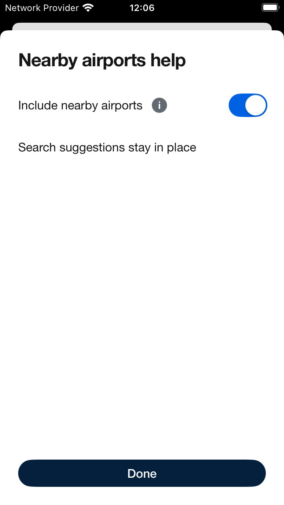
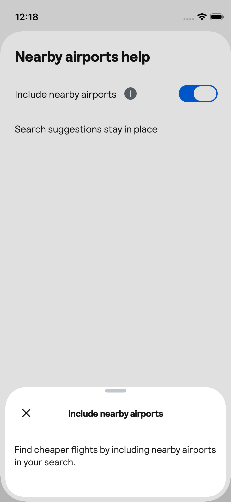
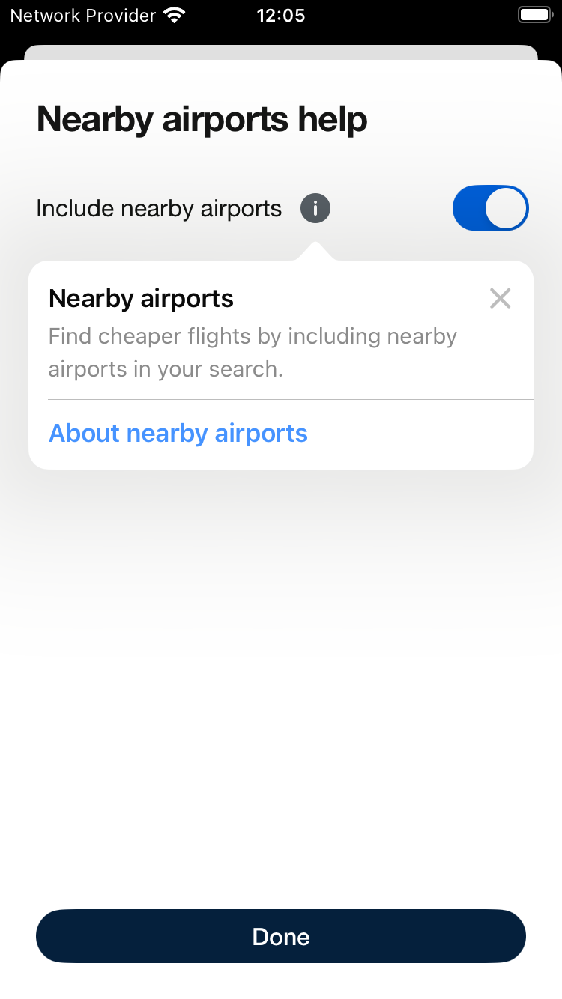
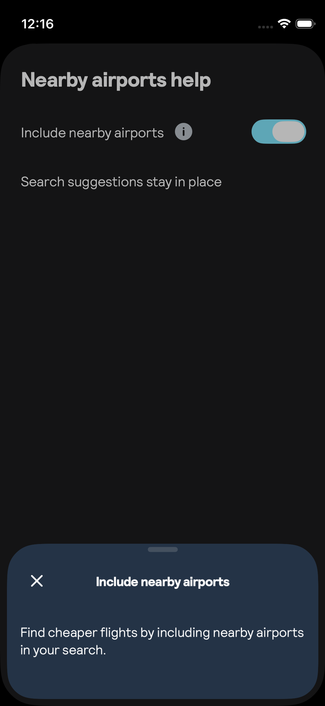

# Nearby Airports information

The switch keeps a neutral information button on every visit. It opens a Backpack bottom sheet. A separate configuration enables an automatic native Apple TipKit introduction, using the same heading and message. The native tip points to the switch control and contains only the title, message and Apple's dismiss control. The information button independently opens the bottom sheet on every visit.

The switch remains a standard on/off switch. The radio-row proposal is no longer part of this design.

## Try it

Open **Switches → SwiftUI → Open experimental switch**. The information button works with **Enable native introduction** off. Enable that separate option to assess the native tip. Apple owns its eligibility and display history; one stable ID shares one introduction across related selectors. The Example-only `SWITCH_INFORMATION_RESET` launch argument resets the test store before TipKit setup.

The consuming app configures TipKit once at launch. On iOS 26+, a bottom attachment anchor and a top-only permitted arrow keep the tip below the switch; earlier supported systems use the native top-arrow preference. The introduction still supports iOS 17+. Native tips can consume the first outside tap to dismiss; the persistent information button remains available afterwards.

The sheet fits its text instead of always taking half the screen. Longer content scrolls. At accessibility text sizes the title joins the scrollable content, keeping it separate from the close control.

## Native captures

Captured on iPhone 12 mini, iOS 26.2, with normal animations.

| Persistent button | Bottom sheet |
| --- | --- |
|  |  |

| Optional Apple introduction | Bottom sheet, dark |
| --- | --- |
|  |  |

Largest text, after scrolling:

## Validation

- Native UI checks cover short-copy sizing, cancelled and completed drag dismissal, both switch values, repeat opening, the native introduction and persisted dismissal, dark mode and the largest accessibility text size.
- Snapshot references are unchanged. Use the toolchain and simulator in `scripts/ios-ci-config` for comparisons.
- The 44-point touch-target check allows only 0.001 point for simulator coordinate rounding; the actual control remains 44 points.
- VoiceOver navigation and iPad have not been manually assessed.
