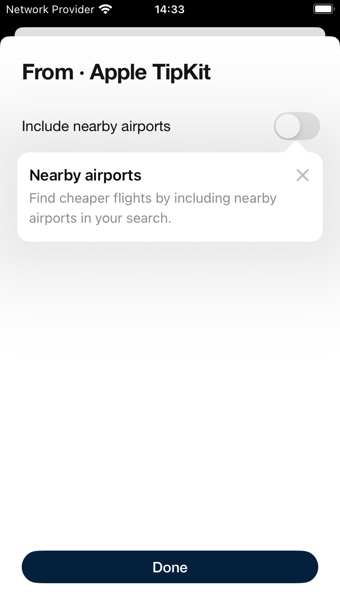
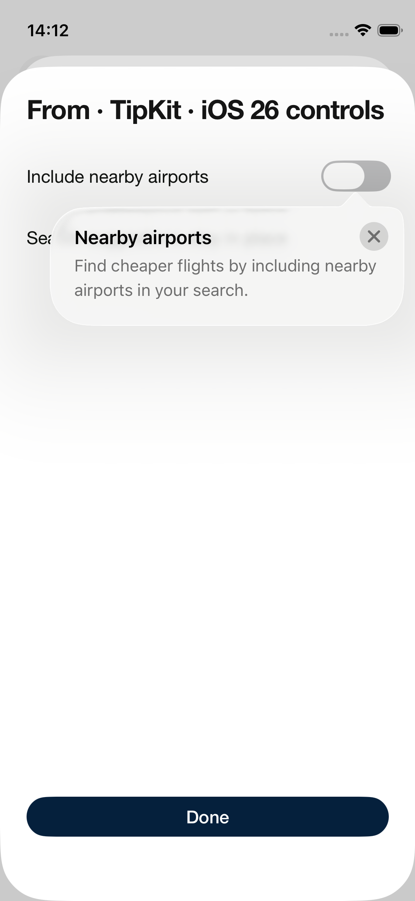
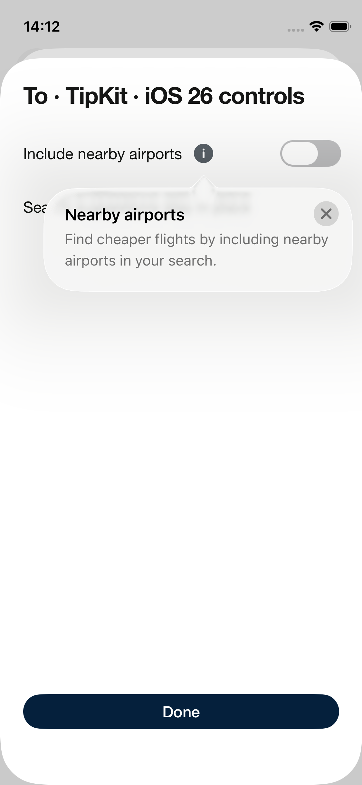
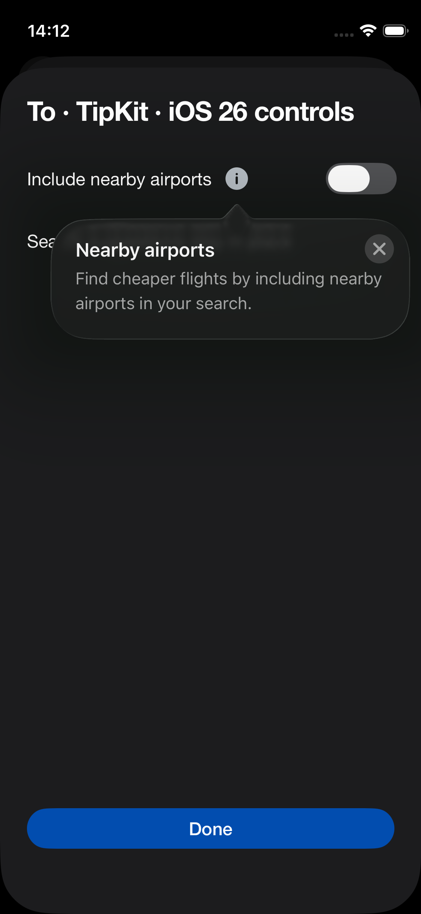
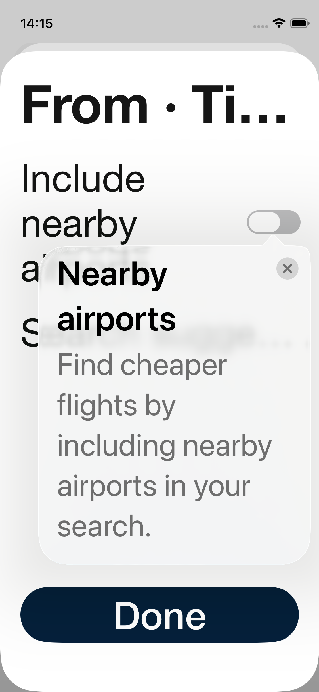
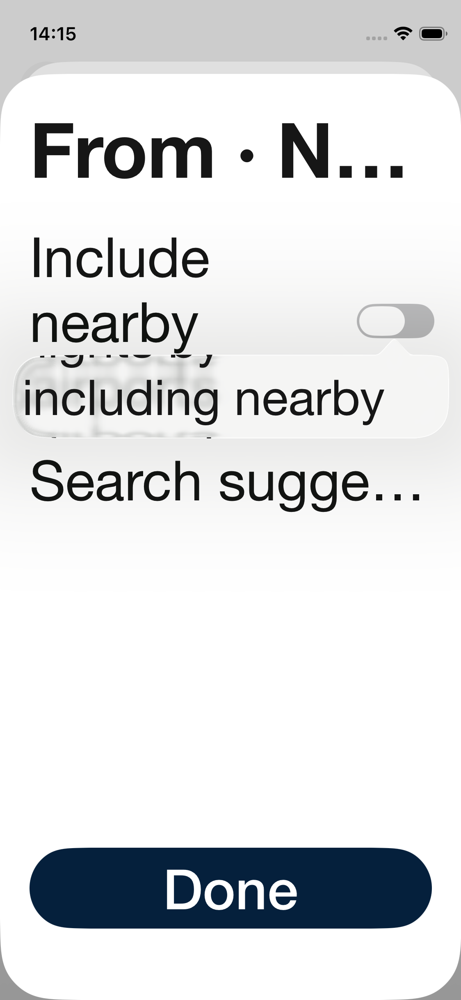

# Apple TipKit assessment for Nearby Airports

TipKit is a viable native option for the requested interaction on iOS 26 and later. A separate Example prototype verifies reopening help, dismissing it with the info button, changing the switch while help is open, and remembering the introduction across app launches. Earlier supported iOS versions need a fallback for the same interaction.

This branch extends the Backpack Example app from the experimental switch branch. It does not replace the implementation in the existing Backpack or app PRs. No shared component API or package resolution changes are included.

## Interaction comparison

| Requirement | Default TipKit on iOS 18.5 | TipKit with iOS 26 controls on iOS 26.2 | Native SwiftUI popover |
| --- | --- | --- | --- |
| Automatic introduction | Yes | Yes | Yes, using app history |
| One introduction across From and To and app relaunch | Yes, using a stable tip ID | Yes, using a stable tip ID and separate introduction history | Yes, using app history |
| Reopen after closing the introduction | The dismissed tip does not reopen | Yes, using per-tip eligibility reset | Yes |
| Tap the info icon again to dismiss | Cannot reopen to reach this state | Yes | Yes, by dismissing the native popover |
| Change switch with one tap while help is open | First tap dismisses the tip without changing the switch | Yes, with background interaction enabled | First tap dismisses; a second changes the switch |
| Leave underlying content in place | Yes | Yes | Yes |
| Arrow follows switch first and info icon later | First presentation verified | Both anchors verified | Both anchors verified |
| Native appearance in light and dark | Yes | Yes | Yes |

The plain SwiftUI popover has been tested on iOS 18.5 and 26.2. Its current prototype clips help at the largest accessibility text size, so it is not a ready fallback. The screenshots retain that finding.

## Why iOS 26 matters

[TipKit closing invalidates a tip](https://developer.apple.com/documentation/tipkit/tips/invalidationreason). Changing a local presentation flag does not make that dismissed tip eligible again. The iOS 26 [presentation binding](https://developer.apple.com/documentation/swiftui/view/popovertip(_:ispresented:attachmentanchor:arrowedge:action:)) controls visibility, while [resetEligibility](https://developer.apple.com/documentation/tipkit/tip/reseteligibility()) allows the same tip to become eligible again. [tipBackgroundInteraction](https://developer.apple.com/documentation/swiftui/view/tipbackgroundinteraction(_:)) enables the switch and info button behind the help. Availability was checked against the installed Apple SDK interfaces.

The prototype keeps introduction history separate from tip eligibility, so reopening help cannot cause a second automatic introduction on a later visit. Reopening resets only this tip, through a cancellable task tied to the selector view. It does not reset the application's TipKit datastore.

TipKit itself starts at iOS 17. The current Place Selector supports iOS 17 and later, and Backpack supports iOS 16 and later. An availability-gated experimental API is feasible; adoption of the iOS 26 controls still needs a compatibility decision.

## Recommendation

Use TipKit if this experiment can target iOS 26 and later. For the full supported app range, retain the current experimental overlay as the earlier-version fallback while evaluating TipKit. Keep the experiment flag, exposure history and copy in the app; let Backpack handle the optional presentation. Configure TipKit once during app initialization.

The default TipKit presentation adds a title and uses the system material, arrow and close button. Design should review that appearance, especially in dark mode. [TipKit styling](https://developer.apple.com/documentation/swiftui/view/tipbackground(_:)) can apply a Backpack surface token if needed. VoiceOver, RTL, iPad and real selector integration still need validation before adopting this prototype in the app.

## Try the prototype

1. Open `Example/Backpack-SPM.xcworkspace` on this branch and run the Example app.
2. Open **Switches**, select **SwiftUI**, then choose **Assess TipKit with iOS 26 controls**.
3. Open **From**, dismiss the introduction, then open **To**. Tap the grey info icon to reopen and dismiss the help. Try the switch while the help is open.
4. Close and relaunch the app. The introduction stays dismissed and the info icon remains available on subsequent visits.

For a direct launch of the basic iOS 17-compatible example, add `TIPKIT_ASSESSMENT_BASIC` to the Example launch arguments. This opens the From selector automatically using the default TipKit API, without the iOS 26 presentation controls. Combine it with `TIPKIT_ASSESSMENT_RESET` for a fresh introduction. Close the tip, open To, then press the info icon to observe that the dismissed tip cannot reopen.

The other two assessment buttons compare default TipKit and a plain native popover. The iOS 26 option is absent on earlier systems. For a fresh assessment, add `TIPKIT_ASSESSMENT_RESET` to the Example launch arguments for one launch, then remove it. This clears only the dedicated assessment store and assessment history before configuring TipKit. No eligibility-bypass testing APIs are used.

## Local validation

Verified on 30 October 2026 with Xcode 27.1:

| Simulator | Result |
| --- | --- |
| iPhone 12 mini, iOS 26.2 | Six assessment UI tests passed, plus one additional lifecycle test; zero failures |
| iPhone SE third generation, iOS 18.5 | Six assessment UI tests plus an additional direct-launch and background-tap check passed; zero failures. Two verify that the iOS 26 option is unavailable |

The lifecycle test leaves the selector while the automatic introduction is still open, then verifies that the other selector shows the info icon and can reopen help. The interaction tests cover dismissal, repeated opening, one-tap switch changes with the iOS 26 controls, unchanged content frames, and history after app relaunch. Light, dark and largest-text captures are included. The default TipKit direct-launch check targets the selector switch by its accessibility identifier and confirms that the first tap dismisses the tip without changing the switch on iOS 18.5. The native popover comparison records the same first-tap behaviour on both tested systems.

Run `TipKitAssessmentUITest` in the `Backpack-UI-Tests` scheme to repeat the assessment. The tests reset only the dedicated assessment history between cases; persistence checks relaunch without resetting it.

## Native screenshots

Basic TipKit using the iOS 17-compatible API, captured on iPhone SE third generation with iOS 18.5:

The following are actual Example simulator captures on iPhone 12 mini with iOS 26.2.

First introduction, attached to the switch:

Help reopened from the grey info icon:

TipKit at the largest accessibility text size:

Largest-text limitation in the plain native popover comparison:

